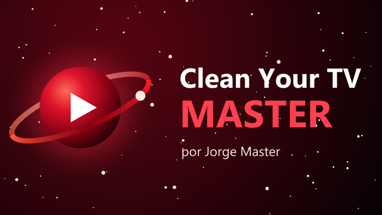

<p align="center"></p>

# Clean Your TV Master

**Criado por Jorge Master.** Uma tela inicial nova para Google TV e Android TV: sem anúncios, em português, com fotos
de filmes e séries em tela cheia, seus apps na ordem que você quer, o **Continuar assistindo** do Stremio, categorias,
trailers de estreias e os botões do controle trocados para o que você usa.

Grátis e de código aberto. Baixe o APK em **[Releases](../../releases)**.

## O que tem

- **Início em tela cheia**: a foto do título em destaque ocupa a tela; troca sozinha a cada 8 segundos, com até 10
  bolinhas para navegar. Relógio, clima e atalhos no topo.
- **Abas**: Explorar, **Continuar**, Filmes e Séries, com um **seletor de categoria** logo abaixo
  (`‹ Top 10 hoje ›`): as setas trocam a lista e, no fim de uma, a próxima entra sozinha.
- **Continuar assistindo (Stremio)**: até 5 títulos da sua conta do Stremio, com barra de onde você parou e o tempo
  que falta. OK abre direto no Stremio, no episódio certo. Trailers e filmes já terminados não entram.
- **Categorias**: Trailers novos, Top 10 hoje, Em alta na semana, Em alta na Netflix, no Prime Video, no Disney+ e na
  HBO Max, Novidades, Nota 8+, Nota 8,5+, Marvel, DC e Anime. Dados do TMDB, atualizados a cada 6 horas
  ("Em alta na Netflix" = os títulos mais populares que estão na Netflix do seu país, não o Top 10 oficial da Netflix).
- **Trailers novos**: as estreias dos próximos 4 meses; OK toca o trailer no SmartTube (ou no YouTube).
- **Sem infantil e sem coisa velha** nas sugestões: só títulos bem avaliados e recentes.
- **Botões do controle**: troque Netflix, Prime Video, YouTube, Globoplay, Disney+ e outros para abrir o app ou a
  entrada HDMI que você quiser, de dentro de qualquer app (testado em TV TCL).
- **Configurações** em preto e vermelho animado, com um painel que explica cada opção: Conta Stremio (liga pelo
  celular com um código, sem senha na TV), Categoria da Início e **Abas e Stremio** (liga/desliga Continuar e
  categorias, onde os títulos abrem, app dos trailers, tempo do destaque, títulos por aba, infantil, saudação).
- **Limpeza da TV**: listas por modelo para tirar anúncios e apps de fábrica, com backup e como desfazer
  ([`README.cleanyourtv.md`](README.cleanyourtv.md)).

## Instalar

Você precisa de um computador com ADB (platform-tools) no mesmo Wi-Fi da TV e a **Depuração de rede** ligada na TV
(Configurações → Sistema → Sobre → aperte OK em **Build** 7 vezes → Opções do desenvolvedor).

```bash
adb connect IP-DA-TV:5555
adb install -r CleanYourTV-Master-2.0.apk
adb shell cmd package set-home-activity --user 0 io.cleanyourtv.ui/.HomeActivity
adb shell input keyevent KEYCODE_HOME
```

Depois, na TV: **Configurações → Conta TMDB** (chave grátis em themoviedb.org) e **Conta Stremio** (abra o link com
o código no celular). Para desfazer, é só desinstalar: a TV volta ao Início original.

```bash
adb uninstall io.cleanyourtv.ui
```

Para os botões do controle em TVs TCL, a TV pede o serviço de acessibilidade ligado
(veja [`launcher-ui/README.md`](launcher-ui/README.md)).

Compilar do código: [`launcher-ui/README.md`](launcher-ui/README.md) (`launcher-ui/build.sh`, sem Gradle).

## Créditos

Clean Your TV Master: **Jorge Master** ([@JorgeMasterAds](https://github.com/JorgeMasterAds)).
Usa a API do TMDB, sem endosso ou certificação do TMDB. Licença MIT: veja [`LICENSE`](LICENSE) e
[`launcher-ui/NOTICE`](launcher-ui/NOTICE).
