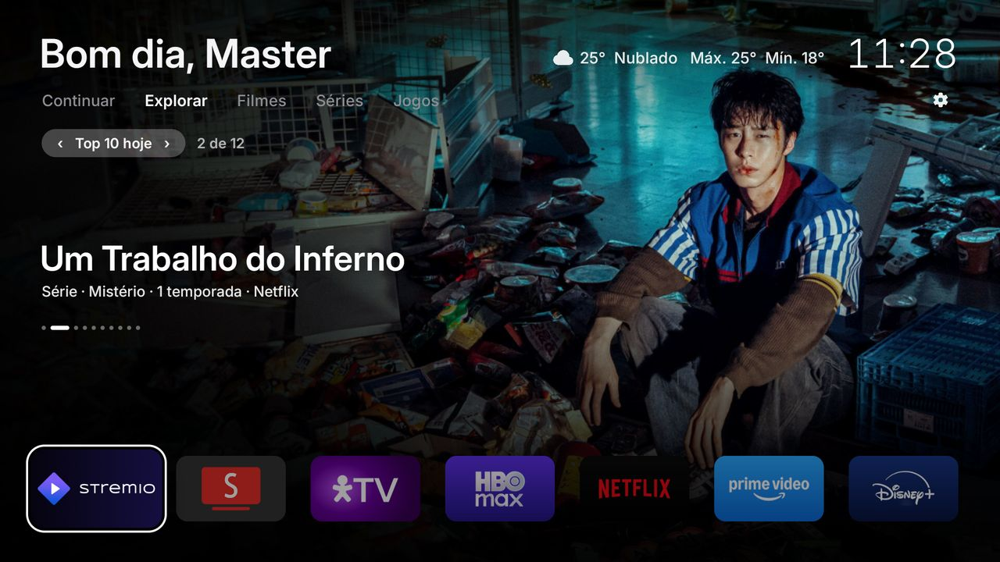
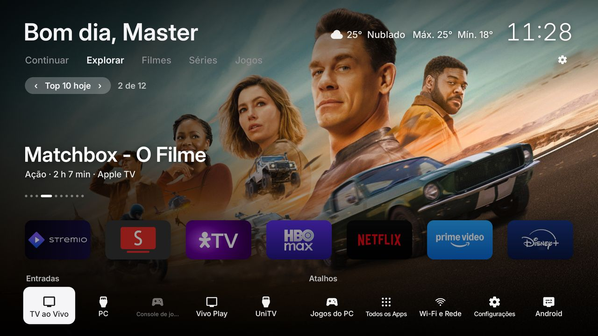
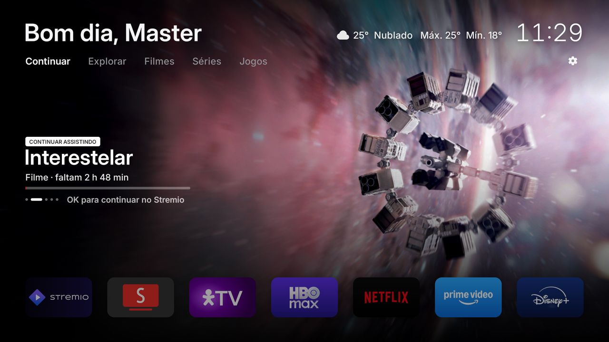
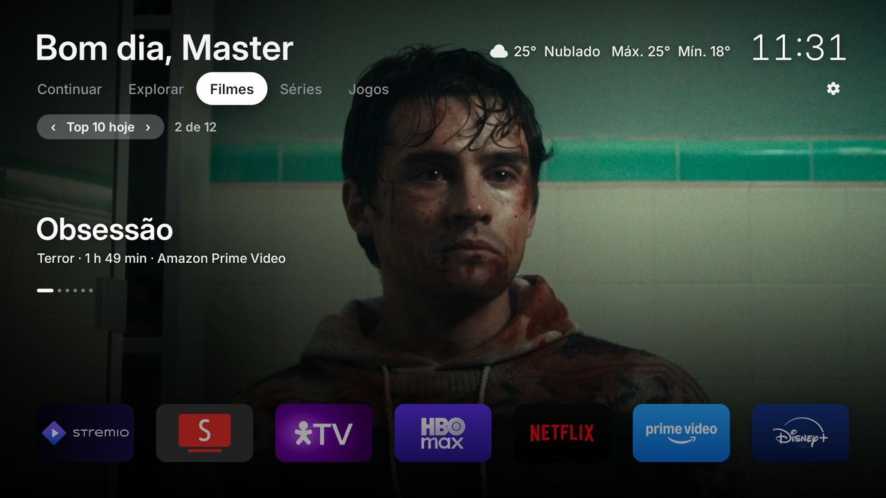
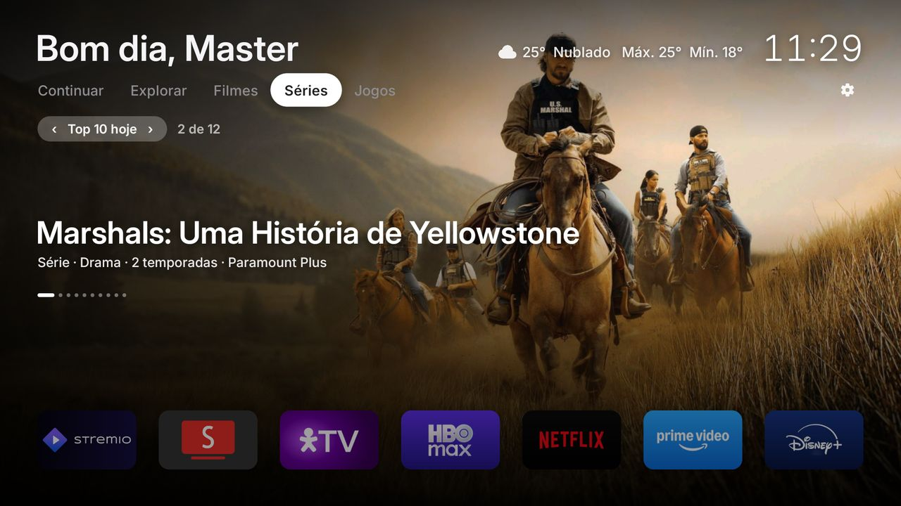
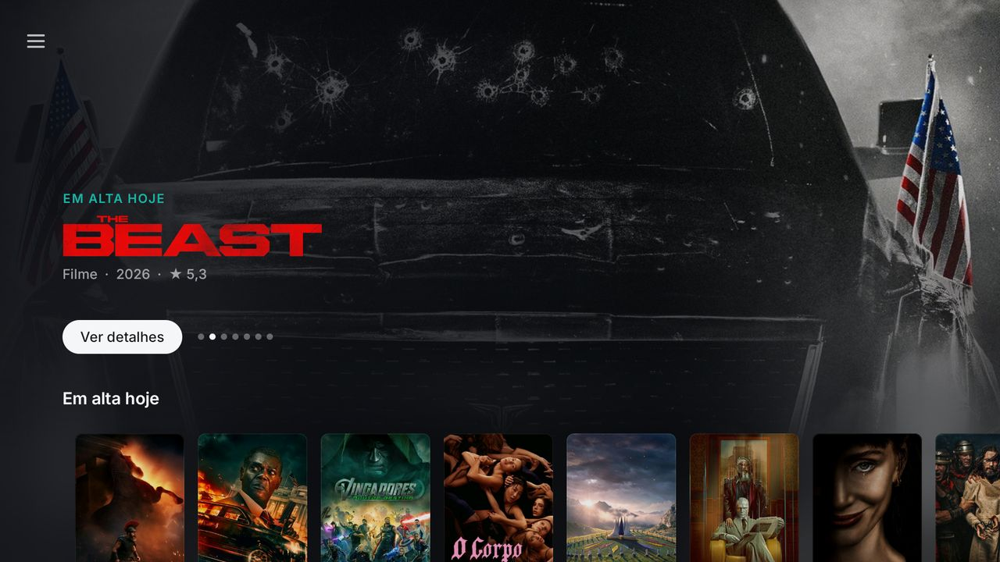
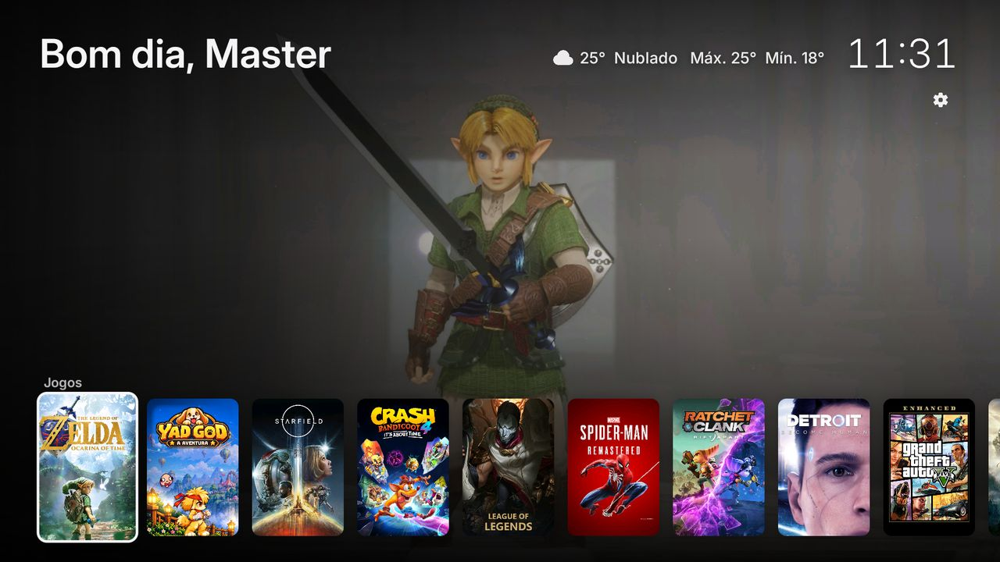
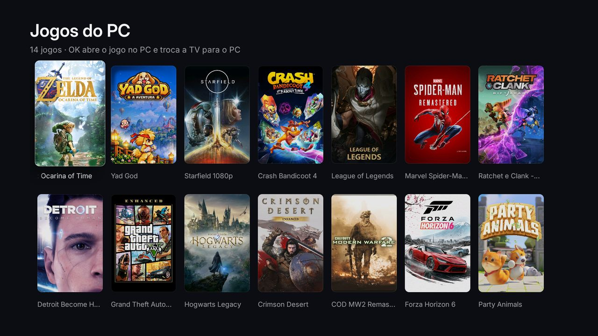
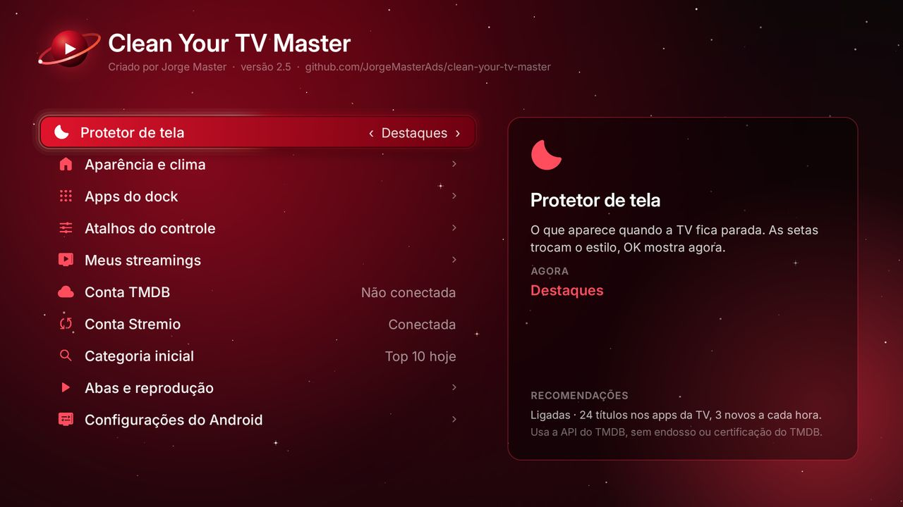

# Dicas de uso do Clean Your TV Master

Atalhos e recursos que nem todo mundo descobre sozinho. Todas as telas abaixo são de uma TV TCL com Google TV.

## 1. A Início



- **← → no destaque** trocam o título; as bolinhas mostram em qual você está. Sozinho, ele troca a cada 8 segundos
  (dá para mudar em Configurações › Abas e reprodução).
- **OK no título** abre direto no app onde ele está (Netflix, Prime Video, HBO Max, Disney+...).
- **`‹ Top 10 hoje ›`**: as setas trocam a lista (Top 10, Em alta na Netflix, Nota 8+, Marvel, Anime...). **OK** nele
  abre a grade com todas as listas.

## 2. O atalho escondido: aperte ↓ nos apps



Com a fileira de apps selecionada, aperte **↓** mais uma vez: aparecem as **Entradas** (TV ao vivo, HDMI do PC, do
console...) e os **Atalhos** (Jogos do PC, Todos os apps, Wi-Fi, Configurações e as configurações do Android). Troca
de HDMI sem abrir o menu da TV.

## 3. Continuar assistindo



A aba **Continuar** traz até 5 títulos que você estava vendo no Stremio, com a barra de onde parou e o tempo que falta
("faltam 38 min", "falta 1 h 9 min"). **OK** abre no Stremio, no episódio certo. Ligue em Configurações › Conta
Stremio (pelo celular, com um código, sem digitar senha na TV). Sem conta do Stremio, a aba some.

## 4. Filmes e Séries

| Filmes | Séries |
|---|---|
|  |  |

Cada aba tem o seu destaque e as mesmas categorias. Infantil e títulos antigos ou mal avaliados ficam de fora.

## 5. Explorar



**OK na aba Explorar** abre a tela de busca e descoberta: em alta hoje, por categoria, por ano. **←** na borda
esquerda abre o menu, onde ficam as categorias que você salvar.

## 6. Jogos do PC na TV

| Na Início | Todos os jogos |
|---|---|
|  |  |

Com o programa **Jogos do PC** rodando no computador ([`pc-games/`](../pc-games/README.md)), a TV mostra os jogos
instalados com as capas:

- **↓ duas vezes** a partir dos apps chega ao dock de jogos. A tela fica só com os jogos e o fundo vira a arte do
  jogo selecionado.
- **OK** abre o jogo no PC e a TV troca sozinha para a entrada HDMI do computador. O PC passa a imagem só para a tela
  que você escolheu para esta TV.
- O jogo **jogado por último** fica à esquerda. Para pôr na ordem que quiser: **segure OK** e mova com **← →**.
- **Fechar pelo controle** (estilo Xbox): segure **LB + RB + View + Menu** por 2 segundos. O jogo fecha, as telas do
  PC voltam como estavam e a TV volta para a Início.
- Se o jogo **não abrir** em 2 minutos, o PC desfaz a troca de telas e a TV volta para a lista dizendo o motivo.
- Para conectar: Configurações › Abas e reprodução › **Jogos do PC** (a TV procura o PC na rede; clique em Sim na
  tela dele). Ali também ficam **Tela do computador** e **Entrada do computador** (em projetor, use "Nenhuma").

Para a TV voltar sozinha à Início quando o jogo fecha, ela precisa da permissão de aparecer sobre outros apps:

```bash
adb shell appops set io.cleanyourtv.ui SYSTEM_ALERT_WINDOW allow
```

## 7. Configurações



Cada opção tem um painel à direita explicando o que faz. Algumas que valem a pena:

- **Protetor de tela**: as setas trocam o estilo, OK mostra agora.
- **Apps do dock**: OK põe ou tira um app; as setas mudam a posição.
- **Atalhos do controle**: troque o que os botões Netflix, Prime Video, YouTube e outros abrem (um app ou uma entrada
  HDMI), de dentro de qualquer app.
- **Aparência e clima**: idioma, °C ou °F, formato do relógio e a cidade do clima.
- **Abas e reprodução**: liga ou desliga abas, onde os títulos abrem, app dos trailers e o nome da saudação.

O que a TV não tem some sozinho: sem Stremio, sem aba Continuar; sem entradas HDMI, a entrada fica em "Nenhuma"; sem
PC conectado, sem aba e dock de jogos.
